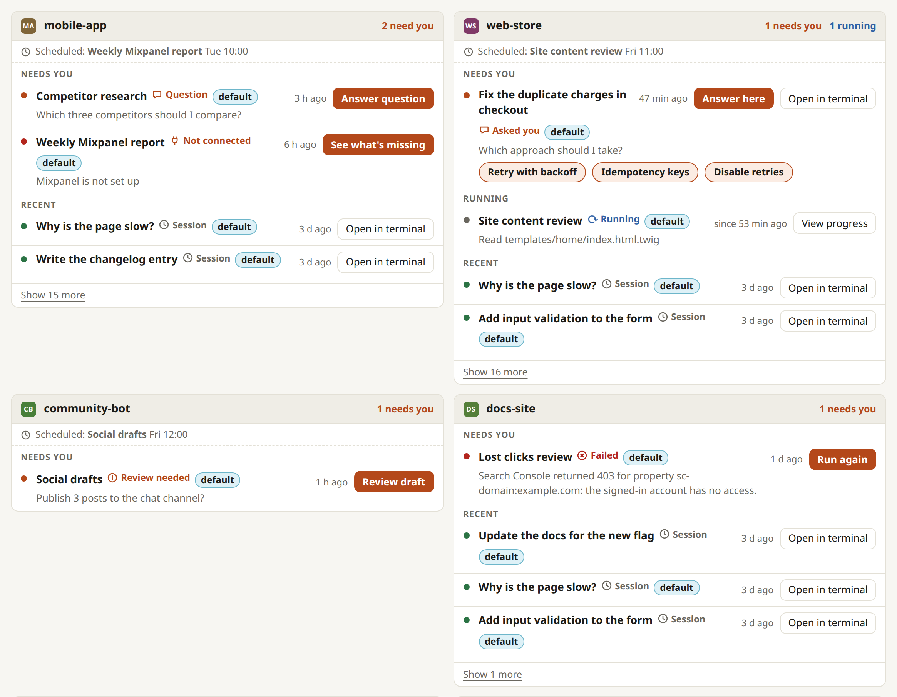
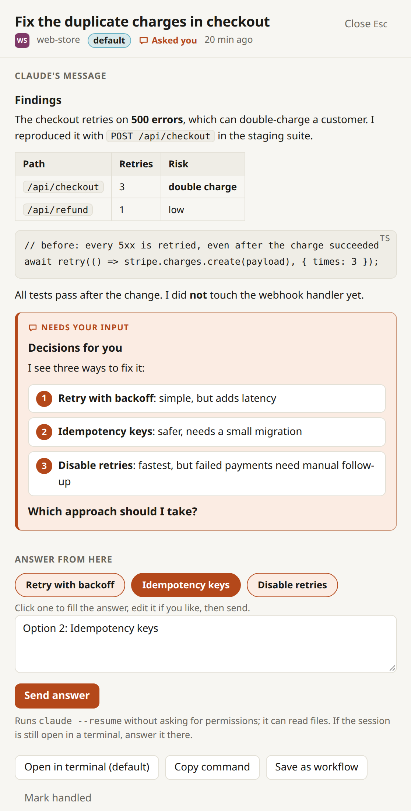
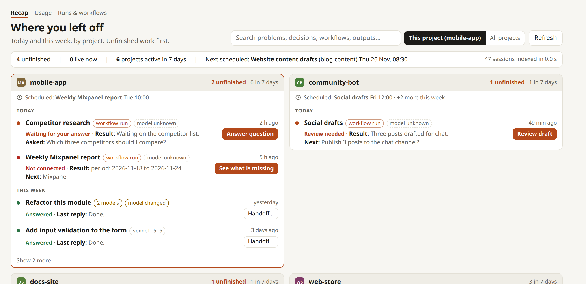
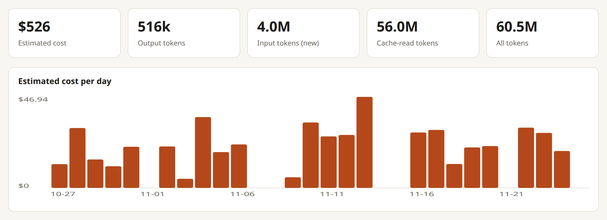
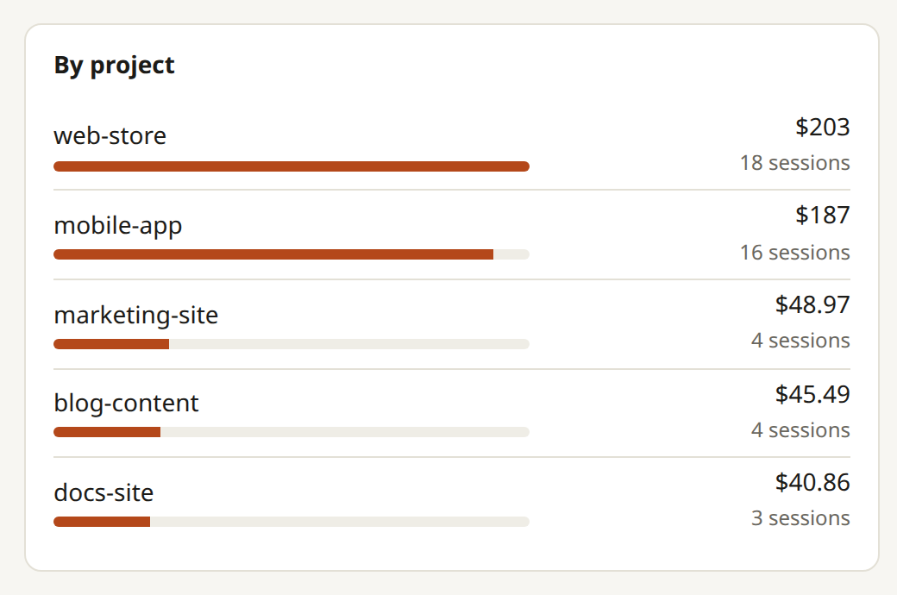
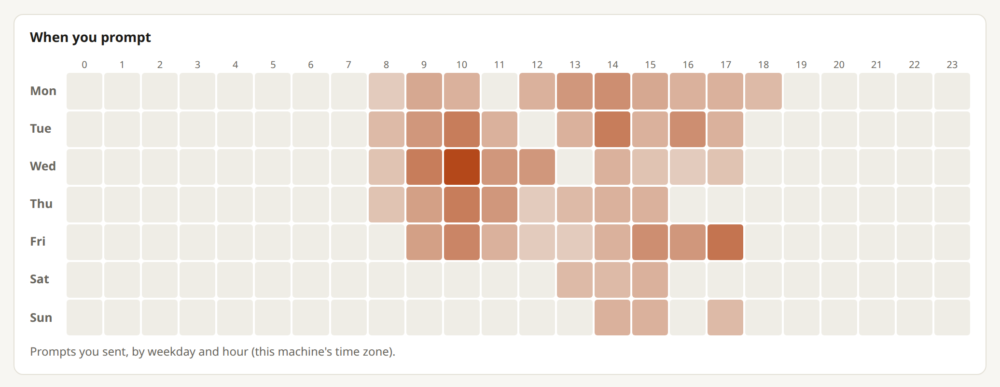

# Claude Forge

> An independent, unofficial tool: not affiliated with Anthropic, and not related to other projects that happen to be called "claude-forge" (a CLAUDE.md generator, a skills collection and others). This one is an inbox for what needs you.

**An inbox for your Claude Code work.** One page that shows, per project, what needs *you* right now (a question a session asked, a permission waiting for approval, a run to review, a pull request) and what got done while you were away. It reads your own transcripts and git on your machine. No account, no cloud, no build step, no dependencies.

<picture>
  <source media="(prefers-color-scheme: dark)" srcset="docs/screenshots/board.png">
  
</picture>

Other Claude Code dashboards mostly show what Claude is doing *right now*: tokens, cost, context. This one answers a different question: **what is waiting on me?**

- **Needs you** from Claude sessions, GitHub, git, checklists, [Linear, Jira and your own scripts](#more-sources-trackers-and-your-own-scripts)
- **Exact live status** with optional [hooks](#live-status-with-hooks-optional): running, finished, or waiting for approval
- **[Notifications](#notifications)** on your desktop or phone
- **[Reply from the browser](#reply-from-the-browser)**, also from your phone
- **[Usage](#usage-page)**: estimated cost and tokens per day, project and model, and a heatmap of when you work
- **[Several machines](#several-machines)** in one inbox
- **Workflows and a scheduler** for saved tasks with a review step before anything is published
- **Private by default**: listens on `127.0.0.1` only, never writes to your transcripts, never reads secrets

## A closer look

**Read the message properly, answer with one click.** Claude's message is rendered as real Markdown (tables, code, lists), and what needs you stands out: questions and "Decisions for you" sections are highlighted, and the options become numbered cards that match the answer buttons. Click one, or write your own, from the browser or your phone. It continues the same conversation in the background.

<picture>
  <source media="(prefers-color-scheme: dark)" srcset="docs/screenshots/reply.png">
  
</picture>

**Where you left off, by project.** Unfinished work first, with the question each session asked.

<picture>
  <source media="(prefers-color-scheme: dark)" srcset="docs/screenshots/recap.png">
  
</picture>

**Usage.** Estimated cost and tokens per day, per project, and when you work.

<picture>
  <source media="(prefers-color-scheme: dark)" srcset="docs/screenshots/usage-chart.png">
  
</picture>

<picture>
  <source media="(prefers-color-scheme: dark)" srcset="docs/screenshots/usage-projects.png">
  
</picture>
<picture>
  <source media="(prefers-color-scheme: dark)" srcset="docs/screenshots/usage-heatmap.png">
  
</picture>

*All screenshots use demo data.*

## Quick start

Requires Node 22+ and the `claude` CLI. Optional: `gh` (logged in) for GitHub items.

```sh
git clone https://github.com/rilwanfit/claude-forge && cd claude-forge
node server.mjs      # then open http://127.0.0.1:4777
```

It finds your Claude profiles itself (`~/.claude` and every `~/.claude-*` that holds sessions). Everything else is optional and set in `config.json` (copy `config.example.json`).

## Where the items come from

| Source | Needs you | Done |
|---|---|---|
| Claude sessions in every profile in `config.json` (last 21 days) | The session's last answer asks you something: a question, or items under a heading such as "Decisions for you" | The session ended without a question (14 days) |
| GitHub, repos owned by `githubOwners` | Open pull requests, open issues with a label in `inputLabels` | Merged pull requests (14 days) |
| Git, every repo you worked in | Uncommitted files in a checkout or worktree, commits not pushed | Commits on any branch (14 days) |
| Checklist files in `inputFiles` | Each unchecked `- [ ]` item | |
| `sources`: Linear, Jira, review requests, your own script | Each open item | |

A session that is working right now shows as "running". Projects appear by themselves once you have a Claude session in them; worktrees count under their main checkout.

Sessions and git are re-read every minute (only the new part of each transcript), GitHub every 5 minutes, and **Refresh** reads everything now. The page reloads its data every minute and when you come back to the tab.

**Mark handled** hides an item until it changes: a new answer in that session, a new push to that PR. Handled items are kept in `state.json`; "show handled" brings them back.

**Copy resume command** gives `cd <folder> && CLAUDE_CONFIG_DIR=<profile> claude --resume <session>` to continue that session in a terminal.

## Setup

`config.json`, `state.json` and `data/` are git-ignored: they hold your own paths and session text, so never commit them. Without a `config.json` the defaults apply; copy `config.example.json` to change them.

## Run

```sh
node server.mjs
```

To start it with your login and keep it running:

```sh
./install-service.sh
```

Stop it with `systemctl --user disable --now claude-forge`.

## Reaching it from other devices

By default only this machine can connect. To open it from your phone or another computer, set a host and a token:

```sh
DASH_HOST=0.0.0.0 DASH_TOKEN=$(openssl rand -hex 24) node server.mjs
```

(or `"host"` and `"token"` in `config.json`). It refuses to start on a non-local host without a token of 16+ characters. Open `http://<machine-ip>:4777/?token=<token>` once; the browser keeps a cookie. There is no TLS: use it only on a network you trust, or put it behind a VPN or an HTTPS reverse proxy (for example Tailscale or Caddy). Anyone with the token can read your session snippets and start Claude runs on this machine.

## Privacy

Unless you set a host (above), it listens on 127.0.0.1 only and refuses requests for any other host name, so other sites in your browser cannot read it. Nothing is sent anywhere except `gh` calls to your own repositories. It reads transcripts but never writes to them, and it never reads `~/.claude-secrets` or `.env` files. Snippets of your sessions show on the page, so only expose it with a token on a network you trust.

## Settings (`config.json`)

`profiles` (Claude config folders), `notify`, `sources`, `peers`, `host`/`token`, `sessionDays`, `doneDays`, `githubOwners`, `inputLabels`, `inputFiles` (`repo` plus `path` of a checklist), `extraRepos` (repos to show without a session), `hideProjects` (by name), `refreshSeconds`, `githubRefreshSeconds`. Restart after a change.

## Limits

"Needs you" for a session is a guess from the wording of its last answer: a question quoted inside a draft text also counts, and a request without a question mark or a decision heading can be missed. Every item can be marked handled.

## Live status with hooks (optional)

Without hooks, "running" is a guess from file times. With them it is exact, and a session that is waiting for you to approve a command shows up as **Needs approval** within a few seconds.

```sh
node hooks/install.mjs              # shows exactly what it will add to each profile's settings.json, then asks
node hooks/install.mjs --uninstall  # removes only its own entries
```

The hook (`hooks/dashboard-hook.mjs`) appends one short line per event (`SessionStart`, `UserPromptSubmit`, `Notification`, `Stop`, `SessionEnd`) to `~/.config/claude-forge/events.jsonl`: session id, event name, folder and the text of a permission request. It uses no network, never prints, and always exits 0, so it cannot block a session. Your other settings and hooks are left as they are, and a backup `settings.json.dashboard-backup` is written first. Sessions already running need a restart to pick the hook up.

## Usage page

`/usage` shows tokens and estimated cost per day, per project and per model, plus a weekday-by-hour heatmap of when you prompt. Cost is Claude Code's own per-session total, spread across the days the session ran by token use, so it is an estimate and not an invoice (on a subscription it is the API-equivalent value). Streamed messages are counted once. Everything is computed locally from your transcripts.

## Notifications

You are told when something new needs you: a permission request (needs hooks, see above), a question a session asked, a run waiting for review, or a failed run. The first pass after a start only learns what is already there, so a restart never replays old items. Nothing is sent for pull requests, issues or checklists.

- **Desktop** (on by default): `notify-send` on Linux, `osascript` on macOS. Stays on this machine and shows the real text.
- **Your phone, in one click**: press **Notifications** at the top of the page, then **Set up phone alerts**. It creates a private topic (kept in `state.json`, never in git) and shows what to do: install the free [ntfy](https://ntfy.sh) app, subscribe to the topic, press **Send test**. Nothing is sent until you do this, because alerts pass through ntfy.sh, a third party; they carry only "Claude needs you", never project names or text.
- **Phone or chat, by hand**: add a webhook or an [ntfy](https://ntfy.sh) topic in `config.json`:
  ```json
  "notify": { "ntfy": { "topic": "a-long-random-topic" }, "webhook": "https://example.com/hook" }
  ```
  These leave your machine, so by default they carry only "Claude needs you / Needs approval". Set `"includeText": true` to send the project name and text too, and only do that for a server you trust. With ntfy, anyone who knows the topic can read it: pick a long random one, or self-host. Set `"publicUrl"` so the notification links back to your dashboard.
- `"events"` picks the kinds (`approval`, `question`, `review`, `failed`); `"desktop": false` turns the desktop popup off; `"notify": false` turns everything off.

## Reply from the browser

When a session asks you something, the card shows **suggested answers** as buttons: Claude's own options when it used a question prompt, or the options it listed in its message ("1. … 2. …", "A or B?"), or Yes / No. Click one (or write your own) and press **Send answer**. Open a session and use **Reply from here** to answer without going to a terminal. It continues the same conversation in the background with `claude --resume` and shows the answer when it is done, which also works from your phone if you [expose the dashboard](#reaching-it-from-other-devices) with a token.

It is deliberately limited: the reply can read files and use only the extra tools you tick (the `toolPresets` in `config.json`); it never stops to ask for permission. It refuses a session that is still open in a terminal, because two programs writing to one conversation would corrupt it, so a live "Needs approval" prompt has to be answered in that terminal. One reply per session runs at a time.

## More sources: trackers and your own scripts

Add anything that needs you to the same inbox with `"sources"` in `config.json`. Each source becomes its own group in the sidebar, is refreshed every `githubRefreshSeconds`, and its items can be marked handled like the others. A broken source shows its error under the sources list and never stops the page.

```json
"sources": [
  { "type": "github-reviews", "label": "Review requests" },
  { "type": "linear", "label": "Linear", "apiKeyEnv": "LINEAR_API_KEY" },
  { "type": "jira", "label": "Jira", "baseUrl": "https://you.atlassian.net", "emailEnv": "JIRA_EMAIL", "tokenEnv": "JIRA_TOKEN" },
  { "type": "command", "label": "Mine", "command": ["node", "my-script.mjs"] }
]
```

- **github-reviews**: pull requests waiting for your review (needs `gh`).
- **linear**: issues assigned to you that are not done. **jira**: your unresolved issues (or set `"jql"`).
- **command**: runs a program (no shell) that prints a JSON array of `{ "id", "title", "url", "line", "ts" }`. That is the way to connect anything else: a ticket CLI, a calendar, a database query.

Secrets are read from environment variables, never from `config.json`. Links must be `http` or `https`; anything else is shown without a link. The command runs with your permissions, so only put commands you trust in your own config.

## Several machines

Each machine keeps its own sessions; nothing is copied or synced. To see what needs you on your other computers, list them as peers. Their items show up in your inbox as read-only entries with the machine's name, linking to that machine's dashboard.

```json
"peers": [
  { "name": "work-pc", "url": "https://work-pc.example.ts.net:4777", "tokenEnv": "WORKPC_DASH_TOKEN" }
]
```

On the other machine, [expose the dashboard](#reaching-it-from-other-devices) with a token, then set that token in an environment variable here (never in `config.json`). Only titles, the question and a label cross over: no resume commands, no answer text, no transcripts. A machine that is off shows its error under the sources list and everything else keeps working. Two machines listing each other do not loop. The token travels with each request, so use HTTPS or a private network such as Tailscale. Notifications still come from the machine where the session runs.

## Workflows and runs

Saved tasks you can run again, schedule, and review. A **workflow** has a project folder, instructions with `{{inputs}}`, allowed tools, optional required connections, an optional output folder, an optional review step and an optional schedule. A **run** is one execution with its own prompt, resolved inputs, log and output folder under `data/runs/<id>/` (never overwritten by a rerun).

- **Save a past session**: "Save as workflow" on any session row opens the form pre-filled with its first prompt and project; nothing is saved until you press Save.
- **Run again** starts a fresh run (same inputs, or "Edit inputs and run"). A period such as "last 7 days" is resolved when the run starts and the real dates are recorded on the run. `{{period}}`, `{{period.previous}}`, `{{today}}`, and your own inputs are available in instructions.
- **Resume** continues the same Claude session (`--resume`). **Restart** stops the active attempt, confirms it is gone, then starts a linked replacement with the same dates; both stay listed. Starts are serialized per workflow, so a double click never starts two copies.
- **Questions and review**: the run ends with `QUESTION:` and waits for your answer, or (review workflows) prepares a draft and waits for Approve/Reject before the publish step, which gets the extra tools only then.
- **Schedule**: weekdays + time in the machine's time zone (`"timezone"` in config.json overrides). The scheduler runs inside `node server.mjs` (checks every 15 s), so the browser can be closed. After sleep or downtime it starts **one** catch-up run per workflow (only if the slot was due within `catchUpWindowHours`, default 12) and lists every other due slot as missed (Scheduler > Details). A workflow set to "Skip" never catches up. Pausing never backfills.
- **Connections** (`connections` in config.json) are checked before a run: an MCP server must be configured for the profile, or a command (e.g. `gh auth status`) must succeed. A missing one blocks the run and says exactly what is missing. Credentials are never put in prompts; log text is redacted (known token shapes and the env vars in `secretEnv`).
- Runner processes are detached, so a dashboard restart does not kill them; the monitor re-attaches by pid. Use `KillMode=process` (already in the service file).

Other config: `maxConcurrent` (2), `needsDays` (2: older session questions go under "Older questions"), `toolPresets`, `claudeBin`, `defaultProfile`.

Tests: `node --test test/*.test.mjs` (a fake Claude, no network). Demo with six projects: `node test/seed-demo.mjs /tmp/dash-demo`, then `DASH_DATA=/tmp/dash-demo DASH_STATE=/tmp/dash-demo/state.json PORT=4799 node server.mjs`.

## Recap (`/recap`)

A second page for the Monday question: where did I leave off, who did the work, what can I resume, rerun or reuse.

- **Overview**: Today / This week grouped by project, unfinished work first, with the best next action per row and upcoming scheduled runs. Worktrees show as their own tag under the same project.
- **Session detail**: where it stands (with a link to the transcript line behind each claim), models and where they changed, a delegation tree (agents, nested agents, workflow runs with phases, the model and result of each, "outcome unclear" when nothing was recorded), outputs, decisions, and what is not recorded.
- **Reuse**: search by problem, decision, workflow or output; defaults to the current project, "All projects" on request. **Create handoff** lets you tick findings, edit everything and see the exact text Claude will receive (credentials removed, transcript text quoted as data). **Start fresh session** opens a terminal in the project folder with exactly that text.
- **Resume** reopens the *original* conversation in its own folder with its own profile (`CLAUDE_CONFIG_DIR=<profile> claude --resume <id>`); it refuses, with the reason, when that folder (for example a removed worktree) is gone. **Rerun** is separate: it starts a new run of a *saved workflow* with visible inputs; earlier runs and outputs stay. One-off sessions stay one-off until you press **Save as workflow**.
- **Indexing** is local and incremental (`data/index.json`, only appended bytes are read, no model call). First pass over ~1.9 GB of transcripts takes a few seconds. `indexDays` (default 60) limits how far back it looks.

What the transcripts do and do not record: `docs/transcript-fields.md`. Tests: `node --test test/*.test.mjs`; the real-page check (headless Chrome, fixture data): `node test/ui-check.mjs [screenshot-dir]`.
